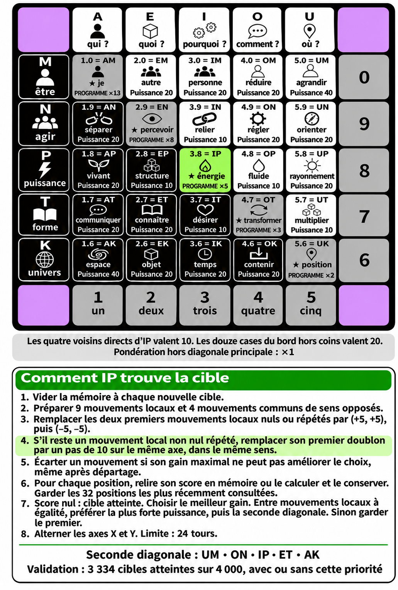
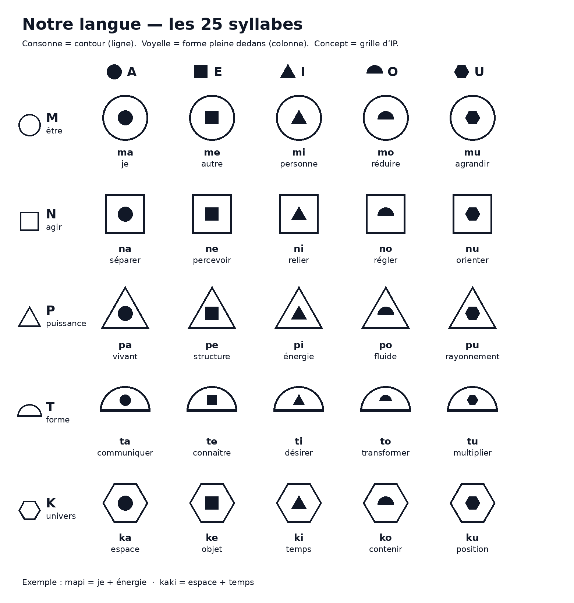

# 🟩 Notre langue

🇫🇷 Une langue construite par Jules Demangeot : **10 lettres, 25 syllabes, une grille de 25 concepts**. Chaque mot veut dire exactement la suite de ses concepts, sans exception et sans devinette.

🇬🇧 *A constructed language by Jules Demangeot: 10 letters, 25 syllables, a 5×5 grid of 25 concepts. Every word means exactly the sequence of its concepts. The full explanation below is in French; the [dictionary](dictionnaire.md) is readable with the grid alone.*

## Sommaire

1. [En bref](#1-en-bref)
2. [Les 10 lettres](#2-les-10-lettres)
3. [La grille : 25 syllabes, 25 concepts](#3-la-grille--25-syllabes-25-concepts)
4. [Les codes chiffrés](#4-les-codes-chiffrés)
5. [Lettres seules : questions et thèmes](#5-lettres-seules--questions-et-thèmes)
6. [Construire un mot](#6-construire-un-mot)
7. [Écrire : les glyphes](#7-écrire--les-glyphes)
8. [Signer : les mains](#8-signer--les-mains)
9. [Faire une phrase](#9-faire-une-phrase)
10. [IP : la grille comme programme](#10-ip--la-grille-comme-programme)
11. [Où la langue est utilisée](#11-où-la-langue-est-utilisée)
12. [Fichiers de ce dossier](#12-fichiers-de-ce-dossier)

## 1. En bref

- **10 lettres** : 5 voyelles `a e i o u` et 5 consonnes `m n p t k`.
- **Une syllabe = une consonne + une voyelle**, soit 25 syllabes. Chacune porte **un concept fixe** de la grille.
- **Un mot = 1 à 3 syllabes**, lues de gauche à droite : *mapi* = je + énergie.
- **Un mot = un sens.** Aucun mot n'a deux sens, aucun sens n'a deux mots.
- **16 285 mots** en tout : 10 lettres seules + 25 racines + 625 mots de 2 syllabes + 15 625 mots de 3 syllabes.
- La langue **s'écrit** en glyphes, **se tape** sur un clavier de 25 touches et **se signe** avec les deux mains.

## 2. Les 10 lettres

| Voyelle | se prononce | | Consonne | se prononce |
|---|---|---|---|---|
| **a** | a | | **m** | m |
| **e** | é | | **n** | n |
| **i** | i | | **p** | p |
| **o** | o | | **t** | t |
| **u** | ou | | **k** | k |

Une syllabe commence toujours par une consonne et finit par une voyelle : *ma, ne, pi, to, ku*… Il n'y a jamais deux consonnes ou deux voyelles de suite dans un mot.

## 3. La grille : 25 syllabes, 25 concepts

Les **lignes** sont les consonnes, les **colonnes** les voyelles. La case où elles se croisent donne le concept de la syllabe.

| | **A** | **E** | **I** | **O** | **U** |
|---|---|---|---|---|---|
| **M — être** | **ma** je | **me** autre | **mi** personne | **mo** réduire | **mu** agrandir |
| **N — agir** | **na** séparer | **ne** percevoir | **ni** relier | **no** régler | **nu** orienter |
| **P — puissance** | **pa** vivant | **pe** structure | **pi** énergie | **po** fluide | **pu** rayonnement |
| **T — forme** | **ta** communiquer | **te** connaître | **ti** désirer | **to** transformer | **tu** multiplier |
| **K — univers** | **ka** espace | **ke** objet | **ki** temps | **ko** contenir | **ku** position |

Au centre se trouve **pi (IP) = énergie**. Les cinq cases étoilées sur la grille (**je, percevoir, énergie, transformer, position**) forment la diagonale principale : ce sont les cases « programme ».

## 4. Les codes chiffrés

Chaque syllabe a aussi un **code** : on écrit la voyelle puis la consonne en majuscules (*pi* → **IP**), et un nombre **voyelle.consonne**.

| Voyelle | A | E | I | O | U |
|---|---|---|---|---|---|
| Chiffre | 1 | 2 | 3 | 4 | 5 |

| Consonne | M | N | P | T | K |
|---|---|---|---|---|---|
| Chiffre | 0 | 9 | 8 | 7 | 6 |

Exemples : *ma* = **AM = 1.0** · *pi* = **IP = 3.8** · *ku* = **UK = 5.6**. Ces chiffres sont aussi ceux qui bordent la grille (1 à 5 en bas, 0 9 8 7 6 à droite).

## 5. Lettres seules : questions et thèmes

Une lettre prononcée ou écrite **seule** a un rôle à part :

- **Une voyelle seule pose une question** : **a** qui ? · **e** quoi ? · **i** pourquoi ? · **o** comment ? · **u** où ?
- **Une consonne seule donne un thème** : **m** être · **n** agir · **p** puissance · **t** forme · **k** univers

## 6. Construire un mot

Un mot se lit **de gauche à droite** : la première syllabe dit de quoi on parle, chaque syllabe suivante précise ce qui est avant elle. Le sens d'un mot est exactement la suite de ses concepts.

| Mot | Syllabes | Codes | Sens |
|---|---|---|---|
| **mapi** | ma-pi | AM IP | je + énergie |
| **kaki** | ka-ki | AK IK | espace + temps |
| **tame** | ta-me | AT EM | communiquer + autre |
| **teke** | te-ke | ET EK | connaître + objet |
| **mutupi** | mu-tu-pi | UM UT IP | agrandir + multiplier + énergie |
| **nekaku** | ne-ka-ku | EN AK UK | percevoir + espace + position |

**Le compte des mots**

| Longueur | Nombre |
|---|---|
| Lettres seules (5 questions, 5 thèmes) | 10 |
| 1 syllabe (les racines) | 25 |
| 2 syllabes | 25 × 25 = 625 |
| 3 syllabes | 25 × 25 × 25 = 15 625 |
| **Total** | **16 285** |

Les 16 285 sens sont tous différents : c'est vérifié par le script qui produit le dictionnaire.

*En test : la « deuxième façon de parler », qui coupe un mot autrement pour lui donner une seconde lecture (par exemple* mapaka *→* map · aka*). Elle est essayée dans le jeu « Les 25 Pouvoirs ».*

## 7. Écrire : les glyphes

Chaque lettre est une forme. **La consonne est un contour vide, la voyelle est la même famille de formes, mais pleine.** Une syllabe s'écrit en mettant la voyelle pleine **dans** le contour de la consonne : **un glyphe = une syllabe**, et un mot de 3 syllabes s'écrit avec 3 glyphes.

| Forme | Consonne (contour) | Voyelle (pleine) |
|---|---|---|
| Cercle | m | a |
| Carré | n | e |
| Triangle | p | i |
| Demi-cercle | t | o |
| Hexagone | k | u |

Dans une phrase, les mots sont séparés par **=** (la touche espace du clavier) : *ma = ti = ta*.

## 8. Signer : les mains

- **Main gauche = consonne**, **main droite = voyelle**.
- On montre **1 à 5 doigts** : 1 = m / a, 2 = n / e, 3 = p / i, 4 = t / o, 5 = k / u.
- Les deux mains prennent leur position **en même temps** : une position = une syllabe.

Exemple : *pi* = 3 doigts à gauche (p) + 3 doigts à droite (i). Ce code est inventé pour la langue : ce ne sont pas des signes de la langue des signes française.

## 9. Faire une phrase

- **Ordre fixe** : sujet, verbe, complément.
- **Aucun mot ne change de forme** : rien ne se conjugue, rien ne s'accorde.
- Chaque mot plein de la phrase devient une syllabe de la grille.

| Français | Notre langue | Mot à mot |
|---|---|---|
| Je désire communiquer. | *ma = ti = ta* | je · désirer · communiquer |
| Je perçois l'énergie. | *ma = ne = pi* | je · percevoir · énergie |
| La personne transforme l'objet. | *mi = to = ke* | personne · transformer · objet |
| Où ? | *u* | où ? |

*À redéfinir avec la grille : la négation, le oui et le non, et la façon de dire le passé et le futur. Ces mots existaient dans la version 0.5, construite sur d'anciennes racines.*

## 10. IP : la grille comme programme

La grille sert aussi de **carte** à un petit programme, **IP** (la case centrale). Chaque case a une **puissance** :

- les quatre voisins directs d'IP (*ni, pe, po, ti*) valent **10**, comme *tu* (multiplier) ;
- *mu* (agrandir) et *ka* (espace), deux coins de la grille, valent **40** ;
- toutes les autres cases valent **20** ;
- les cinq cases étoilées de la diagonale principale sont des **programmes** : *ma* ×13, *ne* ×8, *pi* ×5, *to* ×3, *ku* ×2.

La **seconde diagonale** relie *mu · no · pi · te · ka* (UM · ON · IP · ET · AK).

**Comment IP trouve une cible**, en résumé :

1. Il vide sa mémoire à chaque nouvelle cible.
2. Il prépare 9 déplacements locaux et 4 déplacements communs de sens opposés.
3. Les déplacements nuls ou répétés sont remplacés par des pas plus grands (±5, puis un pas de 10 sur le même axe).
4. Il écarte un déplacement qui ne peut pas améliorer son choix.
5. Il garde en mémoire le score des 32 positions les plus récemment consultées.
6. Il prend le meilleur gain ; à égalité, la plus forte puissance, puis la seconde diagonale. Un score nul veut dire : cible atteinte.
7. Il alterne les axes X et Y, en 24 tours au maximum.

Résultat mesuré : **3 334 cibles atteintes sur 4 000**, avec ou sans la priorité de la seconde diagonale.

## 11. Où la langue est utilisée

- **LYRA** — l'assistante IA personnelle de Jules parle la langue de la grille, hors ligne et sans modèle de langue : `ip dis : je désire communiquer` → *ma ti ta*. Un mot français absent de son lexique est signalé, jamais deviné.
- **Les 25 Pouvoirs** — un jeu où chaque syllabe est un pouvoir et chaque mot un sort, pour apprendre la grille en jouant.
- **Puce 25** — une puce virtuelle (en Verilog) dont le jeu d'instructions est la langue : chaque mot tient sur 16 bits, en trois champs de 5 bits (un par syllabe).

Ces projets sont dans des dépôts privés.

## 12. Fichiers de ce dossier

| Fichier | Contenu |
|---|---|
| [`dictionnaire.md`](dictionnaire.md) | Le dictionnaire lisible : lettres seules, 25 racines (codes et puissances) et les 625 mots de 2 syllabes, rangés par première syllabe |
| [`dictionnaire_16285.tsv`](dictionnaire_16285.tsv) | Les 16 285 mots : numéro, mot, syllabes, codes, sens. S'ouvre dans un tableur ; GitHub permet d'y chercher un mot |
| [`grille_ip.png`](grille_ip.png) | La grille d'IP avec les puissances et l'algorithme de recherche de cible |
| [`glyphes_25_syllabes.png`](glyphes_25_syllabes.png) | Les 25 syllabes en glyphes, avec leur concept |

---

© 2026 Jules Demangeot. Tous droits réservés. La langue a fait l'objet d'un dépôt e-Soleau (INPI) le 16 novembre 2026.
